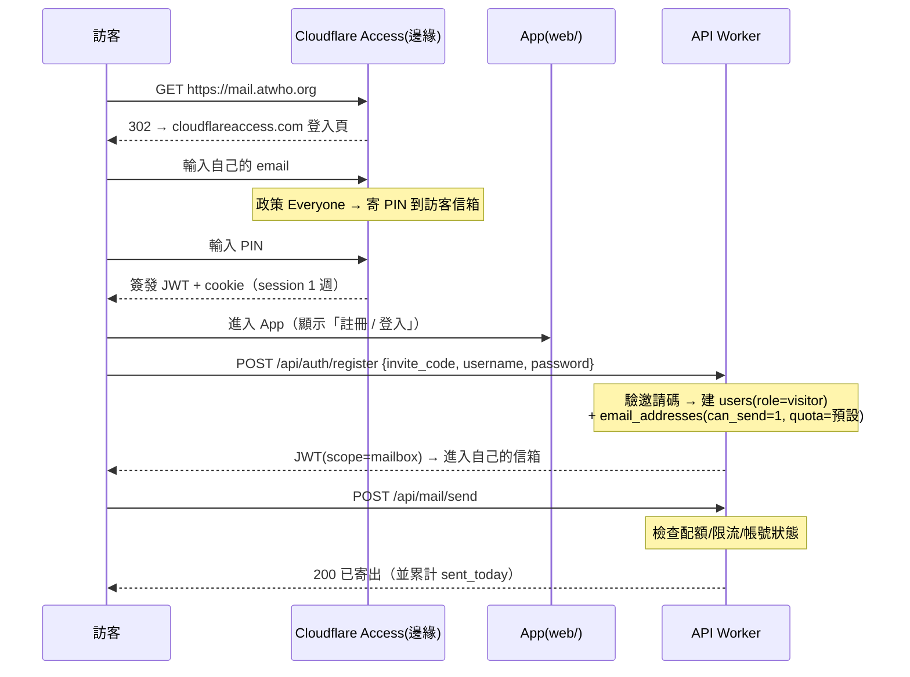
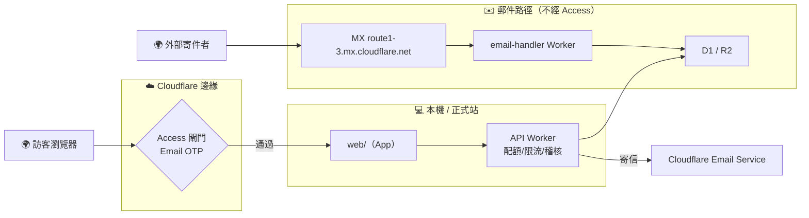

# 13. 開放註冊設計（訪客註冊 ＋ Access 邊緣閘門）

| 項目 | 內容 |
|---|---|
| **狀態** | 🟢 **v0.2 —— 決策已定案（D1–D7 見 §10.3），待你 final review 後進入實作** |
| **版本** | v0.2 ／ 2026-10-08（v0.1 → 見 §0.1 版本紀錄） |
| **前提（已決定）** | ① 訪客用**自己的 email** 收 OTP 通過 Access ② Session Duration ＝**1 週（owner 與訪客皆是）** ③ 進入後由 **App 要求註冊帳號＋密碼** ④ **訪客可以寄信** |
| **相關文件** | `04`（Schema）、`05`（API）、`08`（安全）、`11`（上線清單）、`12`（PWA 整合） |

> ⚠️ **名詞警告**：本文件有兩個「mail」概念，**經常被混淆**：
> - **郵件收發**（SMTP 世界：MX／DKIM／DMARC／Email Routing）→ 由 Cloudflare 郵件服務處理，**不經過 Access**
> - **網頁 UI**（HTTP 世界：`mail.atwho.org` 這個網址）→ 經過 Cloudflare 邊緣，**Access 就在這層**

---

## 0.1 版本紀錄

| 版本 | 日期 | 變更 |
|---|---|---|
| v0.1 | 2026-10-08 | 初稿（10 節；建議 Phase 1「只收不能寄」） |
| **v0.2** | 2026-10-08 | 依決策修訂：**D1 改為「訪客可寄信」** → 新增 §6.5 補償控制（配額／限流／監控／自動斷路）並將配額升級為 **Phase 1 必要**；**D6 改為 owner 與訪客皆 1 週**；§4 風險等級調整；§7～§10 同步 |

---

## 1. 背景與目標

### 1.1 現況（As-Is）

| 項目 | 現況 |
|---|---|
| 使用者模型 | **只有一個 owner**（`users.id=2`，`username=owner`） |
| 信箱地址 | 4 個 active：`test1@`（沙盒）、`tlsrpt@`(id=10)、`alerts@`(id=11)、`app@`(id=12) |
| 認證（應用層） | Model C：① `POST /api/auth/login`（owner，聚合名下全部地址）② `POST /api/auth/mailbox-login`（單一地址，用 `email_addresses.password_hash`，JWT scope=mailbox） |
| 認證（邊緣層） | `mail.atwho.org` 已加 **Cloudflare Access**（app `b17726b0-…`、team `steep-queen-06be.cloudflareaccess.com`、Email OTP） |
| 網頁 UI | `web/`（Vite + React）；`node scripts/dev-web.mjs --tunnel` 一鍵起 本機＋tunnel |
| 寄信 | Cloudflare Email Service（`EMAIL` binding）；DKIM `d=atwho.org; s=cf-bounce` ✅ 已驗證 |
| 反濫用既有資產 | `auth_attempts`（登入失敗鎖定，migration 0002）✅、寄信上限 ≤5 MiB／≤50 收件人 ✅ |

### 1.2 目標（To-Be）

| # | 目標 | 屬於哪一層 |
|---|---|---|
| G1 | 訪客用**自己的 email** 通過 Access（不需 owner 的 Gmail） | 邊緣層（Cloudflare 設定） |
| G2 | 訪客進入後，**在 App 內註冊帳號＋密碼** | 應用層（**需開發**） |
| G3 | 訪客只能使用**自己的**信箱（看不到他人） | 應用層（既有 mailbox scope 已支援 ✅） |
| G4 | **訪客可寄信**，但受配額、限流、監控與停權機制約束 | 應用層（**需開發，§6.5 為必要條件**） |
| G5 | owner 的管理/使用入口**維持只允許自己** | 邊緣層 |

### 1.3 非目標（Non-Goals）

- ❌ 不做管理後台（沿用既有 owner API／x-admin-token）
- ❌ 不改動郵件收發管線（MX／DKIM／DMARC／MTA-STS 完全不動）
- ❌ 不支援手機 App／PWA 離線（依 `12`：桌面網頁為主）
- ❌ 本階段不做「訪客之間的互通」（訪客只能收發自己的信）

### 1.4 名詞定義

| 名詞 | 定義 |
|---|---|
| **Owner** | 你（`ulhome@gmail.com`）：擁有全部地址、可管理、可寄信、可發邀請碼 |
| **Visitor** | 訪客：經 Access 進來、憑邀請碼註冊、**可寄信但受配額限制** |
| **Access identity** | Cloudflare 記錄的訪客身分＝訪客的 email（稽核用，**不是**授權依據） |
| **App account** | 系統資料庫裡的身分：`users` + `email_addresses`（＋密碼） |
| **Address** | 一個收發信地址（`local_part@domain`），屬於某個 user |

---

## 2. 使用者旅程

### 2.1 你自己（現況不變）

| 步 | 動作 | 系統行為 |
|---|---|---|
| 1 | `node scripts/dev-web.mjs --tunnel` | 本機 Vite(5173) ＋ cloudflared tunnel（`atwhomail-dev`） |
| 2 | 開 `https://mail.atwho.org` | Access（**只允許 `ulhome@gmail.com`**）→ Email OTP |
| 3 | 輸入 OTP | **session 1 週**（D6） |
| 4 | App 登入 | `POST /api/auth/login`（owner）或 `mailbox-login`（`app@`） |
| 5 | 收發信 | 既有功能 ✅ |

### 2.2 受邀訪客（本文件的目標流程）



### 2.3 未受邀訪客

| 步 | 動作 | 結果 |
|---|---|---|
| 1-3 | 同 §2.2（Access 通過） | 訪客仍能到登入頁（Access 只當門） |
| 4 | 沒有邀請碼 → 無法註冊 | API 回 `INVITE_INVALID`；App 顯示「需要邀請碼」 |
| — | 嘗試登入 | 無 App 帳號 → 失敗（`auth_attempts` 鎖定生效 ✅） |

### 2.4 邊界情境（實作必處理）

| 情境 | 預期行為 |
|---|---|
| OTP 沒收到／過期 | Access 頁可重寄；PIN 10 分鐘有效（Cloudflare 內建） |
| 邀請碼錯誤／用完／過期 | `INVITE_INVALID`／`INVITE_EXHAUSTED`，不洩漏額外資訊 |
| `local_part` 已存在 | `ADDRESS_TAKEN`（不自動改名） |
| 密碼太弱 | `WEAK_PASSWORD`＋規則說明 |
| 訪客**超過每日配額** | `QUOTA_EXCEEDED`（並累計被拒次數，異常時觸發告警） |
| 訪客短時間大量寄信 | `RATE_LIMITED`（每小時上限） |
| 訪客帳號被停權 | `403 ACCOUNT_SUSPENDED`（寄信與登入皆失效） |
| 訪客嘗試讀他人信件 | `404`（既有 `scopedMessage` ✅） |

---

## 3. 架構分層與職責

| 問題 | 由誰負責 | 說明 |
|---|---|---|
| 能不能**連進來**？ | **Cloudflare Access（邊緣層）** | 只對 proxied 網域生效；與郵件無關 |
| 這個請求**是誰**？ | Access 提供 email 身分 | **不代表**他在 App 有帳號 |
| 他能**用什麼**？ | **App（應用層）** | 由 D1 的 users／email_addresses／session scope 決定 |
| 他**能不能寄信、能寄多少**？ | **App** | 依 `can_send`／`daily_send_quota`／`sent_today`（新欄位） |
| 郵件進不進得來？ | **Cloudflare 郵件服務**（MX／Email Routing） | **完全不經 Access** |



---

## 4. 風險清單（**v0.2：因 D1＝可寄信，R1／R2 升級為「已接受的風險」並強制補償控制**）

| # | 風險 | 觸發條件 | 影響 | 現有防線 | v0.2 定位 |
|---|---|---|---|---|---|
| **R1** | **網域信譽被濫用** | 訪客（或被盜的訪客帳號）用 `@atwho.org` 大量寄信 | 被列黑名單 → 告警信/個人信全進垃圾匣；Cloudflare 可能停權 | SPF/DKIM/DMARC ✅、<=50 收件人 ✅ | ⚠️ **已接受（D1）→ 必須有 §6.5 全部控制** |
| **R2** | 寄信額度被吃光 | 同上 | Cloudflare 每日額度**依帳號信譽動態調整**（官方：新帳號保守額度，隨投遞率與帳號狀態增減）→ 濫用會使額度下調 | 無 | ⚠️ **同 R1**；配額需**遠低於**帳號總額度 |
| **R3** | Vite dev server 暴露 | 任何通過 Access 者 | 開發痕跡／source 洩漏 | API 自身帳密 ✅ | 由 §6.4 兩站分離消除 |
| **R4** | 自助註冊被腳本濫用 | 註冊端點公開 | 垃圾帳號、枚舉、資源灌爆 | `auth_attempts` ✅ | 邀請碼＋rate limit（Phase 1） |
| **R5** | Access 身分 ≠ App 帳號 | 訪客用 A 信箱過 Access、註冊 B 帳號 | 稽核斷鏈 | 無 | 存 `users.access_email` 並記錄比對 |
| **R6** | 管理入口與訪客入口混用 | 同一台 dev server | 你的改動直接影響訪客 | 無 | §6.4 兩站分離 |
| **R7** | 稽核與責任 | 訪客濫用 | 無法回答「誰寄了什麼」 | Access log ✅ | `registration_audit`＋寄信紀錄（messages 已有 ✅） |
| **R8** | 訪客帳號被盜 | 密碼洩漏／撞庫 | 攻擊者以訪客身分寄信 → 觸發 R1 | `auth_attempts` | 停權一鍵生效、異常寄信自動暫停 |

> **結論**：D1 選擇「可寄信」讓 **R1／R2 成為本設計的最高風險**。§6.5 的控制**不是加分項，是這個決定的前提條件** —— 沒有它們，等同把網域信譽交給陌生人。

---

## 5. 選項比較與決策

| | A. 只自己用 | **B. 邀請制（✅ D2 決策）** | C. 自助＋審核 | D. 全開放 |
|---|---|---|---|---|
| 訪客進來方式 | 無訪客 | **需邀請碼** | 自行註冊待審核 | 註冊即可用 |
| R1 濫用風險 | 無 | **低（邀請碼＝問責）** | 低 | 高 |
| 適用 | 自己用 | **朋友/小團體（現在）** | 想開放但節制 | 公開產品 |

**決策理由**：在「訪客可寄信」的前提下，**邀請碼是主要的濫用閘門** —— 因為你只邀請你認識的人，出事時可追溯到「誰邀請的」。這也是為什麼 D2 選邀請制是正確搭配。

---

## 6. 建議方案（Phase 1）

### 6.1 核心原則

1. **Access 只當「門」** —— 授權一律由 App 決定
2. **預設不信任但有額度** —— 訪客 `can_send=1` **但配額極低**，並隨時間與表現調整
3. **兩個入口分離** —— 你的 dev 站 vs 訪客的正式站（§6.4）
4. **可稽核、可秒級停權** —— 出事時你能在 1 分鐘內止血

### 6.2 Phase 1 功能清單

| 功能 | 內容 |
|---|---|
| 邀請碼 | owner 產生（次數上限／到期／備註／可撤銷） |
| 註冊 | `POST /api/auth/register` → 驗邀請碼 → 建 user(role=visitor) ＋ address(`can_send=1`, `daily_send_quota=預設`) → 回 JWT |
| 權限 | 訪客僅能讀寫自己的地址與信件（既有 mailbox scope ✅） |
| **寄信** | **允許，但**通過配額／限流／帳號狀態檢查（§6.5） |
| 稽核 | 註冊、登入、寄信、被拒事件寫入 `registration_audit` |
| 停權 | owner 可 `PATCH /api/users/:id/status`（或直接改 DB）→ 立即生效 |

### 6.3 分期

| Phase | 內容 | 前置 |
|---|---|---|
| **1** | 邀請制註冊 ＋ **可寄信（配額制＋監控＋斷路）** ＋稽核＋停權 | 本文件通過 |
| **2** | 邀請碼管理 UI、訪客配額自助調整、審核制選項 | Phase 1 穩定 ≥2 週且無濫用事件 |
| **3** | 全自助（可選）、濫用偵測（異常寄信模式）、額度自動告警 | Phase 2 數據支持 |

### 6.4 兩站分離（解 R3、R6）

| | 🧑 你的入口 | 🌍 訪客入口 |
|---|---|---|
| 主機 | `node scripts/dev-web.mjs --tunnel`（Vite dev） | `pnpm build:web` → 靜態檔（Workers static assets 或 Pages） |
| Hostname | **`mail.atwho.org`（維持不變，僅你使用）** | **`app.atwho.org`** ✅ 已建立（DNS＋Access 應用；政策**暫為「僅 owner」**，Phase 1 完成後切換 `Everyone`） |
| Access 政策 | `Include: Emails = ulhome@gmail.com` | `Include: Everyone` |
| **Session（D6）** | **1 週（168h）** | **1 週（168h）** |
| 風險 | dev 痕跡只給你自己看 ✅ | 訪客看不到 dev 痕跡 ✅ |

> 註：D6 選擇「兩者都 1 週」代表**訪客裝置登入後 1 週內免 OTP**。此為便利性選擇，風險可接受（因為真正的門檻是**邀請碼**與 **App 帳密**）。

### 6.5 ⚠️ 訪客可寄信的補償控制（**Phase 1 必要，非選配**）

| # | 控制 | 建議值（可調） | 作用 |
|---|---|---|---|
| C1 | **每日寄信配額** `daily_send_quota` | **20 封/日** | 硬上限，防大量寄送 |
| C2 | **新帳號暖機期** | 註冊後 **前 24 小時 5 封** | 防「註冊即轟炸」 |
| C3 | **每小時限流** | **10 封/小時** | 防瞬間爆發 |
| C4 | **每封收件人上限** | 沿用既有 **≤50** | 既有 ✅ |
| C5 | **寄信量監控＋告警** | 任一訪客達配額 **80%** 或全帳號單日 **>200 封** → 寄告警信給你 | 及早發現異常 |
| C6 | **自動斷路（circuit breaker）** | 達配額 → 該地址**當日停寄**並記錄；連續 3 日觸頂 → 自動 `suspended`＋告警 | 無人盯守也能止血 |
| C7 | **一鍵停權** | owner 停權 → **立即失效**（登入與寄信皆擋） | 人工止血 |
| C8 | **安全閥** | 發現濫用時可**單一欄位**把 `can_send` 設 0 → 秒級生效（不動程式） | 緊急應變 |

**另兩項配套（建議同期處理）**

| 項目 | 為什麼 |
|---|---|
| **CORS 收斂**（`ALLOWED_ORIGINS` 由 `*` 改成你的兩個站） | 註冊／寄信端點目前任何網站都能從瀏覽器呼叫（§8.3） |
| **DMARC 升 `p=quarantine`**（`docs/11` 既有待辦） | 萬一仍被冒用，至少能隔離，保護你的收件方信譽 |

---

## 7. 資料模型變更（草案，**尚未執行**）

> 現有 schema 見 `migrations/0001`–`0005`。既有可用：`auth_attempts`（0002）、`email_addresses.password_hash`（Model C）、`users.status`、`messages.send_status`。

### 7.1 新 migration：`0006_visitor_registration.sql`（草案 v0.2）

```sql
-- 1) 使用者角色
ALTER TABLE users ADD COLUMN role TEXT NOT NULL DEFAULT 'owner'
  CHECK (role IN ('owner','visitor'));
-- 2) Access 邊緣層帶來的 email（稽核與比對；R5）
ALTER TABLE users ADD COLUMN access_email TEXT;

-- 3) 寄信權限與配額（Phase 1 必要 —— D1 決策後新增）
ALTER TABLE email_addresses ADD COLUMN can_send INTEGER NOT NULL DEFAULT 1;      -- 0 = 完全不可寄
ALTER TABLE email_addresses ADD COLUMN daily_send_quota INTEGER NOT NULL DEFAULT 20;
ALTER TABLE email_addresses ADD COLUMN sent_today INTEGER NOT NULL DEFAULT 0;
ALTER TABLE email_addresses ADD COLUMN quota_reset_at INTEGER;                    -- 下次配額重置（epoch ms，每日 00:00 UTC 或首次寄信後 24h）
ALTER TABLE email_addresses ADD COLUMN first_send_at INTEGER;                     -- 暖機期計算（C2）

-- 4) 邀請碼
CREATE TABLE invites (
  id          INTEGER PRIMARY KEY AUTOINCREMENT,
  code        TEXT NOT NULL UNIQUE,          -- 隨機 ≥24 字元
  created_by  INTEGER NOT NULL REFERENCES users(id),
  max_uses    INTEGER NOT NULL DEFAULT 1,
  used_count  INTEGER NOT NULL DEFAULT 0,
  expires_at  INTEGER,
  note        TEXT,                          -- 例：「給小明，2026-10 邀請」
  status      TEXT NOT NULL DEFAULT 'active' CHECK (status IN ('active','revoked')),
  created_at  INTEGER NOT NULL,
  updated_at  INTEGER NOT NULL
);

-- 5) 稽核
CREATE TABLE registration_audit (
  id           INTEGER PRIMARY KEY AUTOINCREMENT,
  event        TEXT NOT NULL,   -- register_ok / register_rejected / login_failed / send_rejected_quota / send_rejected_rate / auto_suspended …
  user_id      INTEGER,
  address_id   INTEGER,
  access_email TEXT,
  ip           TEXT,
  user_agent   TEXT,
  detail       TEXT,            -- JSON
  created_at   INTEGER NOT NULL
);
CREATE INDEX idx_reg_audit_time ON registration_audit(created_at DESC);
CREATE INDEX idx_reg_audit_event ON registration_audit(event, created_at DESC);
```

### 7.2 對其他子系統的影響

| 子系統 | 影響 |
|---|---|
| **PG 備份鏡像**（`packages/backup-agent`，現鏡像 5 表） | 需納入 `invites`；`registration_audit` 建議**不**納入鏡像（量大且非信件資料）→ 需在 backup-agent 設定中明列 |
| `docs/04`（Schema） | 同步新增表／欄位 |
| `docs/05`（API） | 新增 §註冊／邀請碼／配額錯誤碼 |
| `docs/11`（上線清單） | 新增「訪客寄信配額與監控」檢查項 |
| `scripts/backup_watchdog.py` | 建議新增「訪客寄信量」檢查（C5 告警） |
| `web/`（前端） | 新增「註冊／邀請碼」畫面、配額顯示、`can_send=0` 時隱藏寄信 UI |

---

## 8. API 契約草案

### 8.1 新端點

| 方法 | 路徑 | 權限 | 說明 |
|---|---|---|---|
| `POST` | `/api/invites` | owner / x-admin-token | 產生邀請碼 `{max_uses?, expires_in_hours?, note?}` → `{code}` |
| `GET` | `/api/invites` | owner | 列出邀請碼與使用狀況 |
| `DELETE` | `/api/invites/:id` | owner | 撤銷邀請碼 |
| `POST` | `/api/auth/register` | **公開（需邀請碼）** | `{invite_code, username, password, local_part?}` → `{token, session:"mailbox", address}` |
| `GET` | `/api/me` | session | `{role, addresses[], can_send, daily_send_quota, sent_today}` |
| `PATCH` | `/api/users/:id/status` | owner | 停權／復權（C7） |

### 8.2 錯誤碼

| 碼 | 情境 |
|---|---|
| `INVITE_INVALID` / `INVITE_EXHAUSTED` | 邀請碼不存在／停用／過期；或次數用盡 |
| `ADDRESS_TAKEN` | `local_part` 或 `username` 已存在 |
| `WEAK_PASSWORD` | 密碼不符規則 |
| `REGISTRATION_DISABLED` | 全站關閉註冊（安全開關） |
| `QUOTA_EXCEEDED` | 超過每日配額（C1／C2） |
| `RATE_LIMITED` | 超過每小時限流（C3）或註冊嘗試過多 |
| `ACCOUNT_SUSPENDED` | `users.status='suspended'` |
| `SEND_NOT_ALLOWED` | `can_send=0`（安全閥 C8 啟用時） |

### 8.3 ⚠️ 註冊與寄信端點的特殊風險（**必須理解**）

1. **API Worker 直連不受 Access 保護** —— `https://atwhomail-api.ulhome.workers.dev` 對全世界開放（既有設計：App 直接打 API）→ **防護必須自己做**（邀請碼＋rate limit＋配額＋稽核），不能依賴 Access。
2. **CORS 目前是 `*`** → 任何網站都能從瀏覽器呼叫你的 API（含未來的註冊端點）。**開放註冊前建議先收斂成白名單**（你的兩個站）。
3. **`auth_attempts`（0002）已提供鎖定機制** ✅ → 註冊／寄信限流應沿用同一套（key 例：`invite:<code>`、`ip:<ip>`、`send:<address_id>`）。
4. **配額判定順序**（避免 TOCTOU）：`帳號狀態 → can_send → 限流 → 配額 → 寄出 → 累計`，並在 `sent_today` 更新時採**原子操作**（`UPDATE ... SET sent_today = sent_today + 1 WHERE ... AND sent_today < daily_send_quota`，依影響列數判斷是否放行）。

---

## 9. 濫用防護與維運

| 面向 | 作法 |
|---|---|
| 註冊限流 | 沿用 `auth_attempts`：per-IP＋per-邀請碼失敗計數與鎖定 |
| 寄信管制 | §6.5 C1–C3（配額／暖機／限流）＋ C4（收件人上限） |
| 偵測與告警 | §6.5 C5（達 80% 或全帳號 >200/日 → 寄信告警給你） |
| 自動止血 | §6.5 C6（達配額當日停寄；連續 3 日觸頂自動 suspended＋告警） |
| 人工止血 | §6.5 C7（一鍵停權）、C8（`can_send=0` 秒級安全閥） |
| 稽核 | `registration_audit`（註冊／登入／寄信／被拒）＋ `messages`（寄信內容與收件人）＋ Access log（訪客 email） |
| 官方額度事實 | Cloudflare Email Service 每日寄信上限**依帳號信譽與投遞率動態調整**（新帳號為保守額度）→ **訪客配額必須遠低於帳號總額度**，並把「信譽」當資產保護 |
| 演練建議 | 上線後第 1 週：每日檢查寄信量與被拒事件；第 1 位訪客上線後 48 小時內做一次人工複核 |

---

## 10. 驗收清單、分期與決策記錄

### 10.1 邊緣層驗收（可立即執行）

```bash
curl -sS -o /dev/null -w "%{http_code} %{redirect_url}\n" https://mail.atwho.org/
# 預期：302 https://steep-queen-06be.cloudflareaccess.com/cdn-cgi/access/login/mail.atwho.org...
```

### 10.2 應用層驗收（Phase 1 完成後）

```bash
# 1) 產生邀請碼（owner）
curl -sS -X POST https://atwhomail-api.ulhome.workers.dev/api/invites \
  -H "x-admin-token: $ADMIN_TOKEN" -H 'Content-Type: application/json' \
  -d '{"max_uses":1,"expires_in_hours":72,"note":"給小明"}'
# 預期：{"code":"..."}

# 2) 用邀請碼註冊
curl -sS -X POST https://atwhomail-api.ulhome.workers.dev/api/auth/register \
  -H 'Content-Type: application/json' \
  -d '{"invite_code":"<上一步>","username":"friend01","password":"<強密碼>","local_part":"friend01"}'
# 預期：200 {"token":"...","session":"mailbox","address":{"email":"friend01@atwho.org"}}

# 3) 訪客可以寄信（配額內）
curl -sS -X POST https://atwhomail-api.ulhome.workers.dev/api/mail/send \
  -H "Authorization: Bearer <訪客 token>" -H 'Content-Type: application/json' \
  -d '{"from":"friend01@atwho.org","to":["test1@atwho.org"],"subject":"hello","text":"hi"}'
# 預期：200 {"send_status":"sent"}，且 GET /api/me 的 sent_today 由 0 → 1

# 4) 超過配額被擋（C1/C2）
#    連續寄到超過 daily_send_quota（或新帳號前 24h 的第 6 封）
# 預期：429 {"error":{"code":"QUOTA_EXCEEDED"}}，且 registration_audit 出現 send_rejected_quota

# 5) 停權立即生效（C7）
curl -sS -X PATCH https://atwhomail-api.ulhome.workers.dev/api/users/<id>/status \
  -H "x-admin-token: $ADMIN_TOKEN" -H 'Content-Type: application/json' -d '{"status":"suspended"}'
# 之後訪客寄信／登入 預期：403 ACCOUNT_SUSPENDED

# 6) 訪客看不到他人信件（既有保護）
curl -sS https://atwhomail-api.ulhome.workers.dev/api/mail/inbox -H "Authorization: Bearer <訪客 token>"
# 預期：僅自己的信，不含 owner 的信

# 7) 稽核可查
#    registration_audit 應有 register_ok / send_rejected_quota / auto_suspended 等事件
```

### 10.3 決策記錄（D1–D7，**已定案**）

| # | 問題 | **你的決定** | 衍生影響 |
|---|---|---|---|
| **D1** | 訪客能否寄信？ | ✅ **可以寄信** | 觸發 §6.5 全部補償控制（C1–C8）為 Phase 1 必要；R1／R2 列為最高風險並已接受 |
| **D2** | 註冊管制 | ✅ **邀請碼**（路線 B） | 邀請碼＝濫用閘門與問責依據 |
| **D3** | 地址形式 | ✅ `<username>@atwho.org` | 需檢查 `local_part` 唯一性 |
| **D4** | 一人幾個地址 | ✅ **1 個** | 註冊即建 1 個；要更多需 owner 加開 |
| **D5** | 保留僅 owner 的管理入口 | ✅ **要** | 兩站分離（方案 B）：`mail.atwho.org` 僅你使用、`app.atwho.org` 為訪客入口（§6.4） |
| **D6** | Session Duration | ✅ **owner 與訪客皆 1 週（168h）** | Access 應用改為 168h（你已改好或我調整）；便利性↑、風險由邀請碼＋App 帳密承擔 |
| **D7** | 訪客資料隔離 | ✅ 依既有 mailbox scope | 訪客只看自己的 address_id（既有邏輯 ✅） |

### 10.4 通過本文件後的第一步

| 順序 | 動作 | 負責 |
|---|---|---|
| 1 | 你 final review 本 v0.2 | 你 |
| 2 | ✅ **已完成（2026-10-08）**：① 所有 Access 應用 Session 改 `168h` ② 建立訪客入口 **`app.atwho.org`**（proxied CNAME → `atwhomail-dev` tunnel ＋ Access 應用 `AtWhoMail Visitors - app.atwho.org`；政策**暫為僅 owner**，Phase 1 完成後切換 `Everyone`）③ 曾同日建立備援 `mail-dev.atwho.org`，**已於當日刪除**（DNS 由 owner 於 Dashboard 刪除、Access 應用由助手刪除；實測該網域已 **無法解析** ✅，zone 記錄數回到 24）。驗證 **13/13**：三網域邊緣皆 302、TLS 涵蓋、cloudflared 註冊、Vite 接受三個 Host、收尾無殘留 | 我 |
| 3 | ✅ **已完成並生效（2026-10-08）**：`packages/api/wrangler.jsonc` 的 `ALLOWED_ORIGINS` 由 `*` 收斂為 `https://mail.atwho.org,https://app.atwho.org,http://localhost:5173,http://127.0.0.1:5173`；由 owner 於 Dashboard 套用（線上已生效）。**線上實測**：4 個允許來源皆 204＋ACAO 回顯；`evil.example`／後綴偽造／`null` 皆無 ACAO；GET 的 CORP 分別為 cross-origin／same-origin ✅ | 我／你 |
| 4 | migration `0006`（D1 本地＋ remote 執行）＋ 備份鏡像納入 `invites` | 我 |
| 5 | API 端點（invites／register／me／status）＋ 配額邏輯 | 我 |
| 6 | `web/` 註冊畫面（**需與 Claude Code 協調**，它目前在改 `web/`） | 我／Claude Code |
| 7 | 驗收（§10.2 全部指令） | 我 |

> ⚠️ 第 6 項有**併行風險**：Claude Code 正在編輯 `web/`。建議在它 commit 之後再動前端，或由它實作、我驗收。

---

### 10.5 Phase 1 上線紀錄（2026-10-13）

| 項目 | 結果 |
|---|---|
| 訪客入口 `app.atwho.org` | ✅ **Cloudflare Pages `atwhomail-web`**（永久在線，不依賴本機 tunnel） |
| Access 政策 | ✅ 改為 **Bypass / Everyone**（公開；⚠️ 原設計寫「切 Everyone」但不夠精確 —— `Everyone` 仍要求 One-time PIN） |
| API | ✅ `pnpm deploy:api` 已部署（Version `05c4ef22-…`） |
| D1 | ✅ migration `0006` 已套用（`invites`、`registration_audit`、`role`、配額欄位） |
| CORS 白名單 | ✅ 含 `https://app.atwho.org`，preflight 204 ＋ ACAO 回顯 |
| 配額（C1–C8） | ✅ 端到端驗證：暖機 5/日、每日 20、每小時 10、`can_send=0`、停權、稽核 |
| owner 帳號 | ✅ 由 `owner` 改名為 **`itag`**（D11 上線後執行；救援通道不受影響） |

詳細部署紀錄、驗收證據與後續待辦見 `docs/14` 附錄 B。
